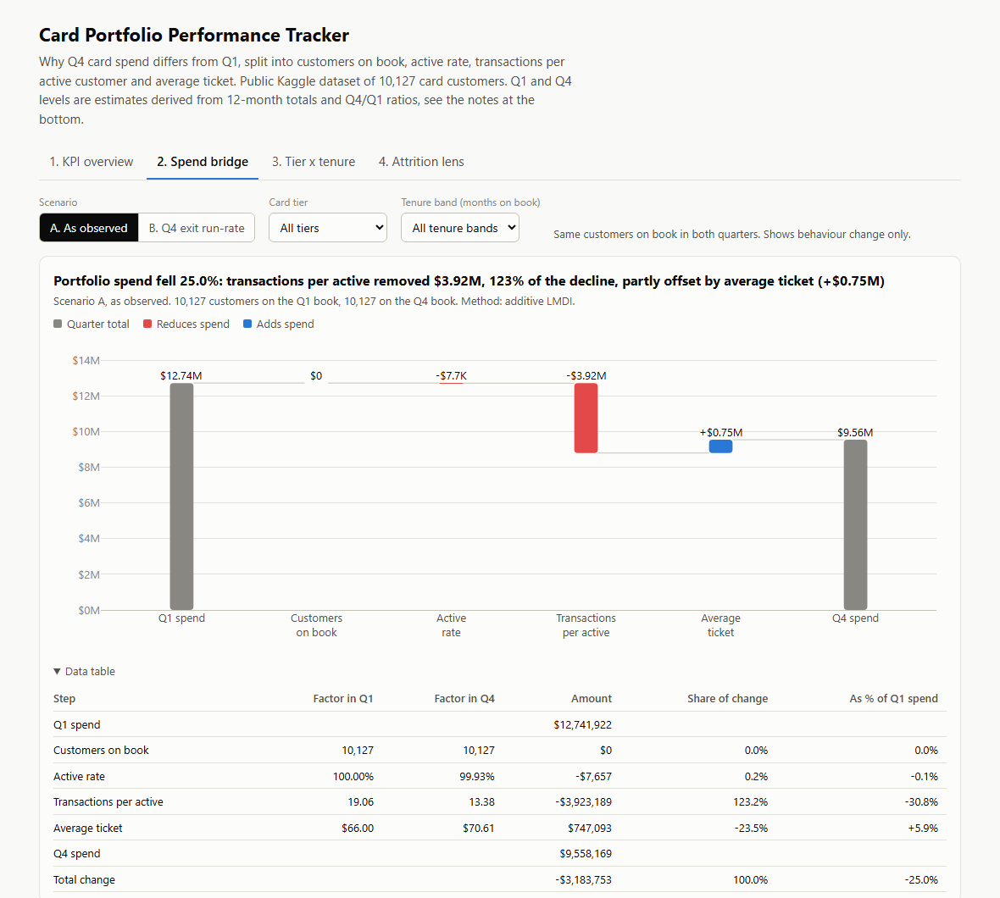
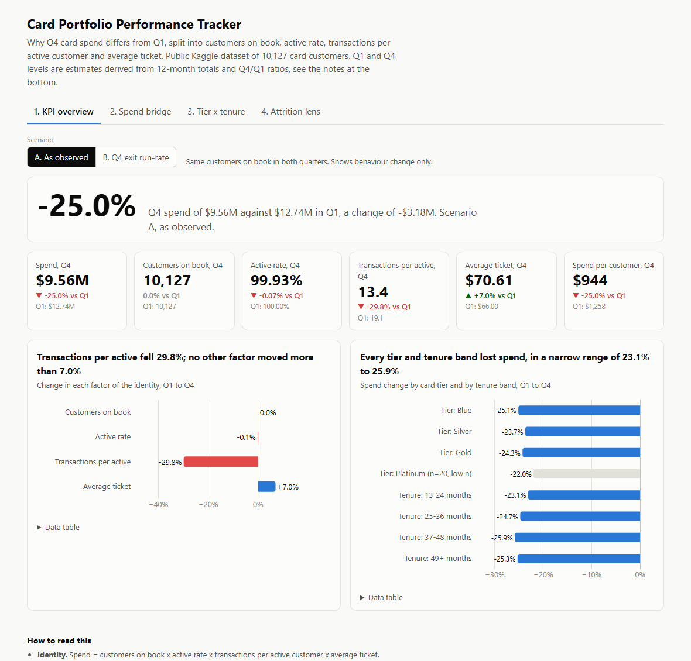
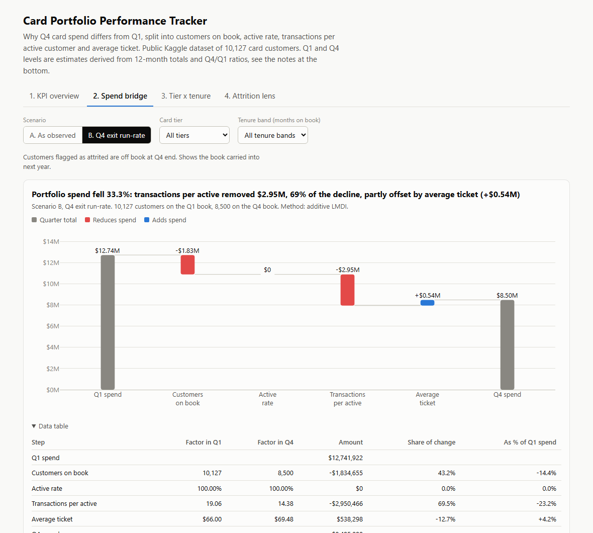
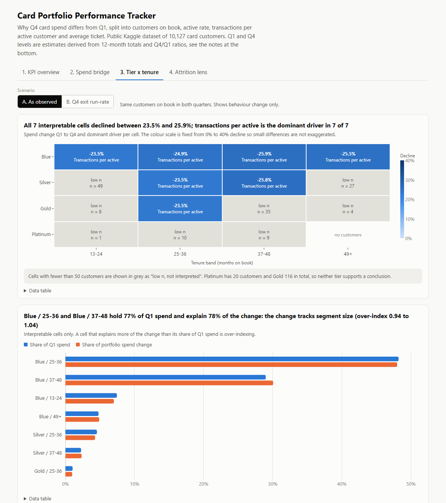
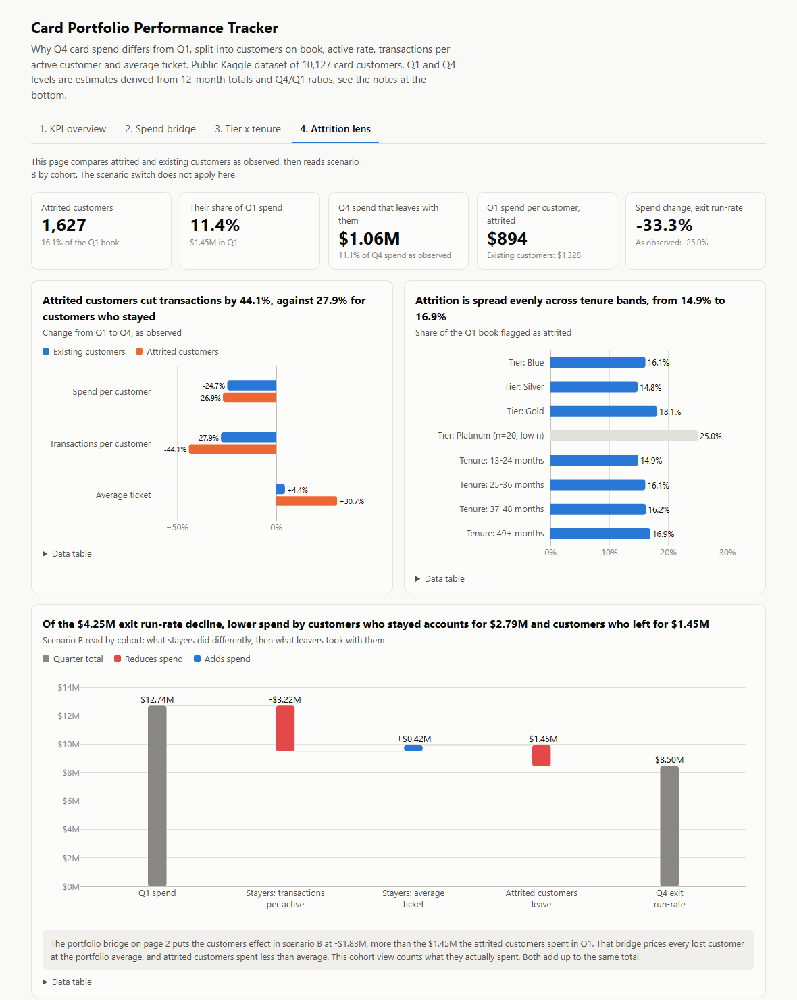

# Card Portfolio Performance Tracker

**Question.** Q4 card spend differs from Q1. How much of the change came from customers on book, active rate, transactions per active customer, and average ticket, and which segments drive it?

**Answer.** Spend fell 25.0% ($12.74M to $9.56M). All of it is lower transaction frequency (down 29.8%), partly offset by a 7.0% higher average ticket, and every tier and tenure band declined by about the same amount. Removing attrited customers deepens the fall to 33.3%.

**Recommendation.** Treat it as a portfolio-wide usage problem: aim the recovery at transaction frequency in the Blue core (77.2% of spend), and use falling frequency as the retention trigger, ranked by spend at risk.



**[Live dashboard](https://tharun0127.github.io/card-portfolio-performance-tracker/)** · [One-page memo](docs/memo.md) · [All result tables](docs/results.md) · [Assumptions and sensitivity](ASSUMPTIONS.md) · [Power BI build kit](powerbi/POWERBI_BUILD_GUIDE.md)

    

A portfolio analytics project: a decomposition framework and dashboards for tracking card spend performance, built on a public dataset of 10,127 card customers. The quarterly values are estimates. The dataset has 12-month totals and Q4/Q1 ratios, not quarterly levels, so Q1 and Q4 are derived under a stated assumption and tested against two alternatives.

## What this project shows

| Skill | What I did | Where to look |
|---|---|---|
| Decomposition frameworks | Split a spend change into four additive effects with LMDI, which leaves no residual and does not depend on factor order. Cross-checked against sequential substitution | [mart_decomposition.sql](sql/marts/mart_decomposition.sql), [decomposition.py](src/decomposition.py) |
| SQL | Layered DuckDB pipeline (staging, intermediate, marts) with CTEs, grouping sets and window functions | [sql/](sql) |
| Python | Independent pandas rebuild of the whole analysis, used to validate the SQL | [python_pipeline.py](src/python_pipeline.py), [validate.py](src/validate.py) |
| Dashboards | 4-page interactive dashboard with scenario, tier and tenure slicers, and a Power BI star schema with commented DAX | [docs/index.html](docs/index.html), [powerbi/](powerbi) |
| Testing | Unit tests on known-answer cases, SQL tested on synthetic cells, SQL tested against Python on the real data | [tests/](tests) |
| Handling weak data | Missing quarterly levels handled with a documented assumption and a sensitivity check. Small samples flagged, not interpreted | [ASSUMPTIONS.md](ASSUMPTIONS.md), [data profile](docs/data_profile.md) |
| Communication | One-page memo with the answer first, findings with numbers, recommendations and limits | [docs/memo.md](docs/memo.md) |

## Proof

Everything in this section is produced by the build and can be reproduced with one command.

### 1. The dashboard

Four pages. Every chart title is generated from the data and states the takeaway for the current selection.

| | |
|---|---|
| **1. KPI overview**  | **2. Spend bridge, exit run-rate scenario**  |
| **3. Tier x tenure heatmap**  | **4. Attrition lens**  |

The screenshots are taken by the build from [docs/index.html](docs/index.html) with a headless browser.

### 2. Two implementations agree

The decomposition is written twice: once in DuckDB SQL, once in pandas straight from the raw file. The build fails if they differ by more than 1e-6. From the last build ([full log](docs/proof/build_log.txt)):

```
== Validate SQL against Python ==
  SQL vs Python: 156 cells, 27 columns, largest difference 1.05e-08 on effect_txns_per_active (tolerance 1e-06)
  max_abs_residual_effects_vs_change: 2.515e-08
  max_abs_gap_segments_vs_portfolio: 2.794e-09
  max_abs_gap_fact_vs_mart_spend: 0.000e+00
  linear_q1_plus_q4_over_annual_total: 5.000e-01
Validation passed
```

In plain terms: across 156 cells the two implementations agree to a hundred-millionth of a dollar, the four effects add up to the spend change, segments add up to the portfolio, and the Power BI fact table reproduces the marts.

### 3. Tests pass

```
== Run tests (pytest) ==
........................................................................ [100%]
72 passed
```

What the 72 tests cover:

- effects sum to the total change, for LMDI, sequential substitution and the average over all factor orders
- a zero-change case gives zero effects
- a single-factor change is attributed entirely to that factor
- a cell with a zero factor falls back to sequential substitution and is flagged
- the SQL model gives known answers on hand-built cells
- SQL and Python agree on the real data within 1e-6
- the Power BI star schema reproduces the pipeline result for all 48 slicer combinations

### 4. Every quoted number is traceable

The numbers in this README and in the memo are not typed from memory. [check_docs.py](src/check_docs.py) reads both files on every build and fails if a number is not found in [headline_numbers.json](outputs/headline_numbers.json) or the build log.

### 5. Check it yourself

```powershell
git clone https://github.com/Tharun0127/card-portfolio-performance-tracker.git
cd card-portfolio-performance-tracker
.\run_all.ps1
```

This creates the environment, downloads the data, rebuilds every output file and runs the tests. A rebuild from an empty folder reproduces the committed outputs exactly.

## Results

| | A. As observed | B. Q4 exit run-rate |
|---|---:|---:|
| Q1 spend | $12.74M | $12.74M |
| Q4 spend | $9.56M | $8.50M |
| Change | -25.0% | -33.3% |
| Customers on book | $0 | -$1.83M |
| Active rate | -$7,657 | $0 |
| Transactions per active | -$3.92M | -$2.95M |
| Average ticket | $0.75M | $0.54M |
| Total change | -$3.18M | -$4.25M |

- **Frequency explains the decline.** Transactions per active customer fell from 19.1 to 13.4 a quarter. That is 123.2% of the net decline, because average ticket rose from $66.00 to $70.61 and pulled the other way.
- **It is broad, not a segment problem.** All 7 interpretable tier x tenure cells declined between 23.5% and 25.9%, with frequency as the dominant driver in each. No cell explains more or less of the decline than its size predicts (over-index 0.94 to 1.04).
- **Attrition deepens it.** 1,627 customers (16.1%) are attrited. They held 11.4% of Q1 spend and cut transactions by 44.1%, against 27.9% for customers who stayed.
- **One factor is flat, and the dashboard says so.** Only 7 customers are inactive in Q4, so the active rate explains 0.2% of the change.

## Method

**Data.** Kaggle dataset `sakshigoyal7/credit-card-customers` (`BankChurners.csv`). The two columns starting with `Naive_Bayes_Classifier` are dropped because they leak the attrition label.

**Identity.**

```
spend = customers on book x active rate x transactions per active x average ticket
```

Each factor is a ratio of two totals, so the identity holds exactly for the portfolio and for every segment. Each factor also maps to a different lever: acquisition and retention, activation, usage, and ticket size.

**Decomposition.** Additive LMDI (logarithmic mean Divisia index). Each factor's effect is the log mean of Q1 and Q4 spend multiplied by the log of the factor's ratio. The four effects add up to the spend change with no residual and do not depend on the order of the factors. A cell with a zero factor falls back to sequential substitution and is flagged.

**Scenarios, switchable in the dashboard.**

- A, as observed: the same customers are on book in Q1 and Q4.
- B, Q4 exit run-rate: customers flagged as attrited are off book at Q4 end.

**Segments.** Card tier x tenure band (13-24, 25-36, 37-48, 49+ months). Cells with fewer than 50 customers are flagged "low n, not interpreted". Platinum (20 customers) and Gold (116 customers) are tiny and are not used for any conclusion.

**Pipeline.**

```
data/raw/BankChurners.csv
  -> sql/staging        stg_customers                 clean, rename, drop leaked columns
  -> sql/intermediate   int_customer_quarters         derive Q1 and Q4 under each assumption
                        int_customer_segments         tier x tenure, cell sizes, low-n flag
                        int_customer_quarter_scenario apply scenarios A and B
  -> sql/marts          mart_cell_quarter, mart_cell_period   aggregate to five grains
                        mart_decomposition (+ _long)          LMDI with sequential fallback
                        mart_segment_contribution             share of the portfolio change
                        mart_mix_reconciliation               portfolio effects vs sum of cells
                        pbi_*                                 Power BI star schema
  -> src/python_pipeline.py   independent pandas rebuild from the raw file
  -> src/validate.py          assert SQL and Python agree within 1e-6
```

## How to run

Requirements: Python 3.11 and a Kaggle API token in `~/.kaggle/` (Kaggle > Settings > API).

Windows:

```powershell
.\run_all.ps1
```

macOS or Linux:

```bash
./run_all.sh
```

Either script creates `.venv`, installs the pinned `requirements.txt`, and runs `run_all.py`, which:

1. downloads `BankChurners.csv` into `data/raw/` if it is missing
2. profiles the raw data
3. runs the SQL models in DuckDB and exports the marts and the Power BI CSVs
4. rebuilds the decomposition in Python and asserts it matches the SQL within 1e-6
5. writes `docs/results.md` and `outputs/headline_numbers.json`
6. builds `docs/index.html`
7. takes dashboard screenshots if Edge or Chrome is installed
8. runs the tests and saves the build log
9. checks that every number quoted in the memo and this README was produced by the pipeline

If the Kaggle download fails, download the file by hand from https://www.kaggle.com/datasets/sakshigoyal7/credit-card-customers and put `BankChurners.csv` in `data/raw/`. The raw data is git-ignored.

## Assumptions

Full detail, derivation and sensitivity results are in [ASSUMPTIONS.md](ASSUMPTIONS.md). The ones that matter most:

1. **Quarterly values are derived.** If a customer's quarterly values move in a straight line, Q1 + Q4 equals half the 12-month total. With `r` as the Q4/Q1 ratio from the data, `Q1 = total / (2 * (1 + r))` and `Q4 = r * Q1`. This is applied to both spend and transaction count.
2. **Sensitivity.** Under two alternative assumptions (all change in Q4, or all change right after Q1) the decline is between 24.1% and 26.0%, frequency stays the dominant driver, and no interpretable segment changes rank. Dollar levels are less stable than percentages.
3. **Active** means at least one transaction in the quarter.
4. **Attrition has no date.** Scenario B assumes attrited customers are gone by the end of Q4.

## Limitations

- One Q1 and one Q4. Seasonality cannot be separated from trend.
- The decomposition is descriptive. It shows which factor moved, not why.
- Premium tiers are too small to read.
- In scenario B the portfolio-level customers effect prices each lost customer at the portfolio average. The attrition page shows the cohort view next to it.
- The Power BI deliverable is a build kit: star schema CSVs, commented DAX, a theme and a step-by-step guide. The data and the measure logic are tested by the pipeline. A finished `.pbix` is not included, and the guide has a check table to confirm the report against the pipeline once it is assembled.
- This is a public teaching dataset. Nothing here describes a real issuer.

## Repository map

| Path | Contents |
|---|---|
| `sql/` | DuckDB models: staging, intermediate, marts |
| `src/` | Pipeline runner, Python decomposition, validation, report, dashboard builder |
| `tests/` | pytest suite |
| `outputs/` | Mart CSVs and headline numbers |
| `powerbi/` | Star schema CSVs, `measures.dax`, theme, build guide, expected values |
| `docs/` | Dashboard (`index.html`), memo, results, data profile, screenshots, build log |
| `ASSUMPTIONS.md` | Derivation of the quarterly values, sensitivity check, every modelling rule |
| `PLAN.md` | The plan written before the build, and what changed |

## Author

Built by [Tharun0127](https://github.com/Tharun0127).
